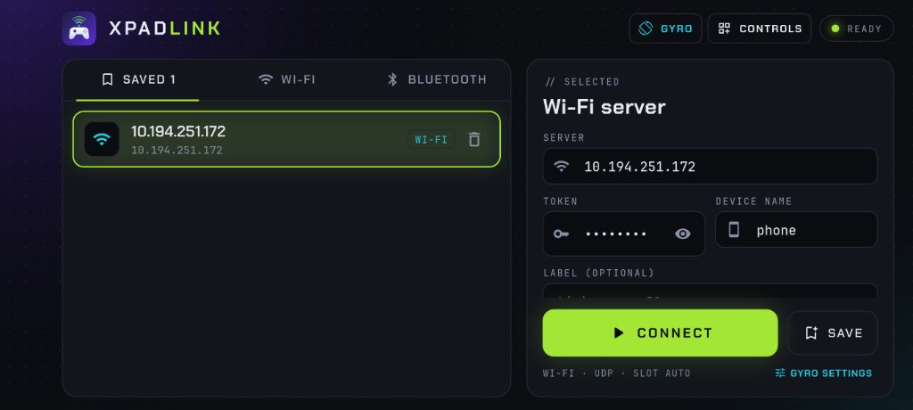
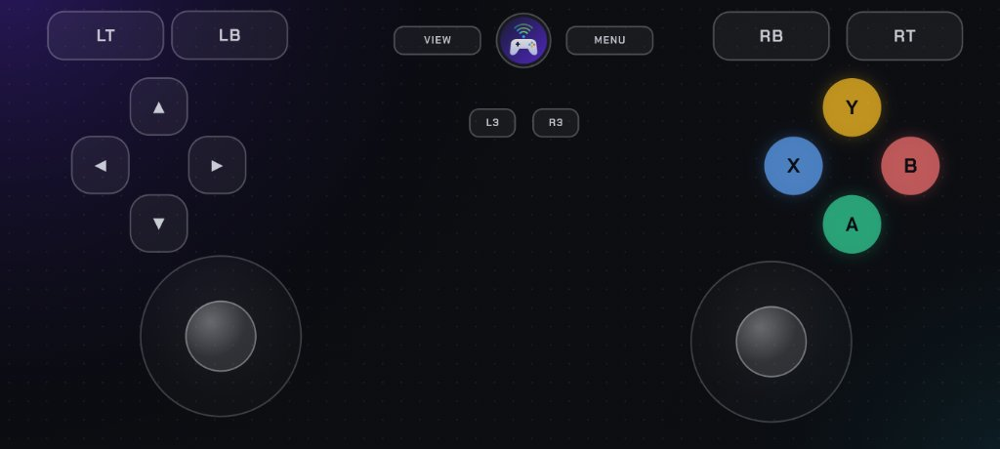
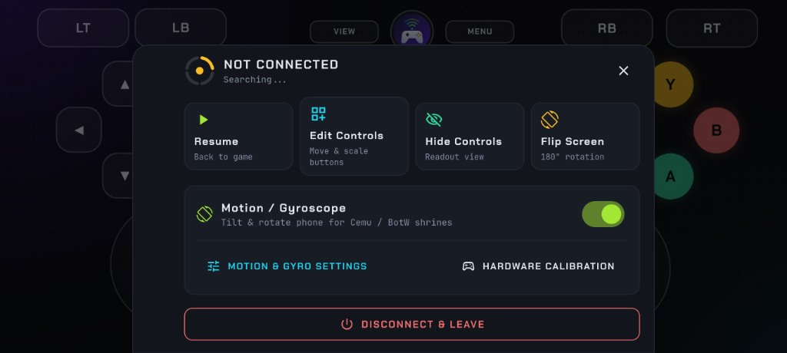
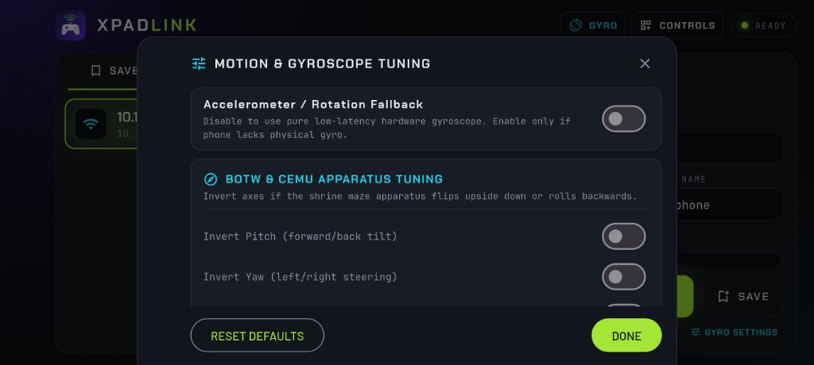
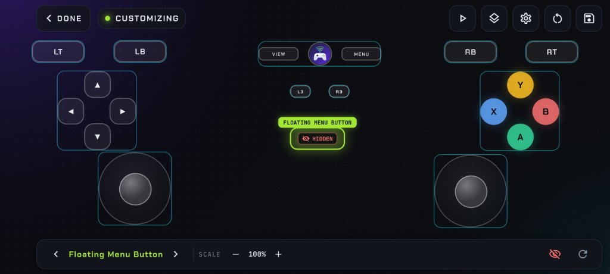
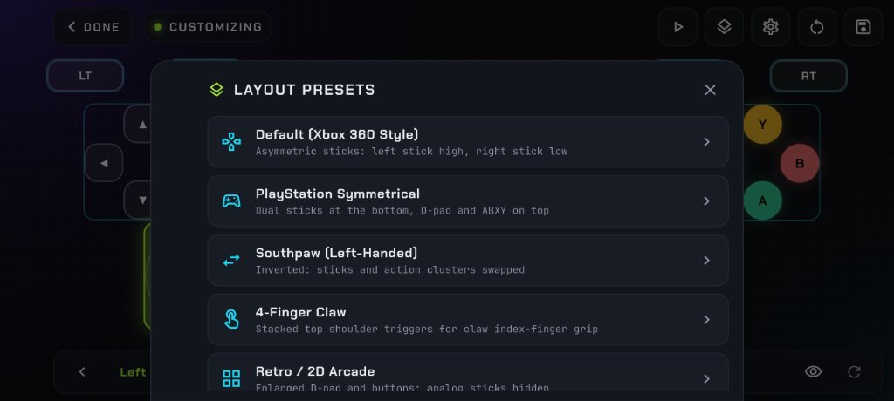
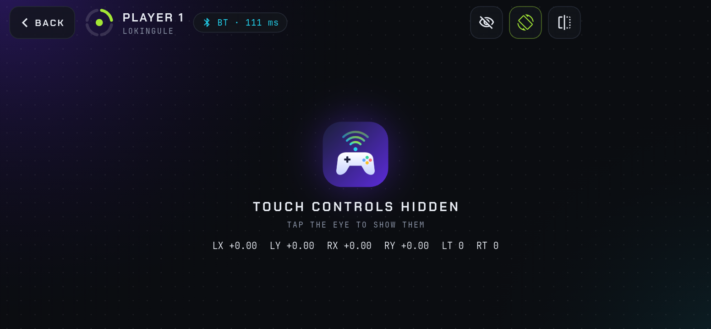
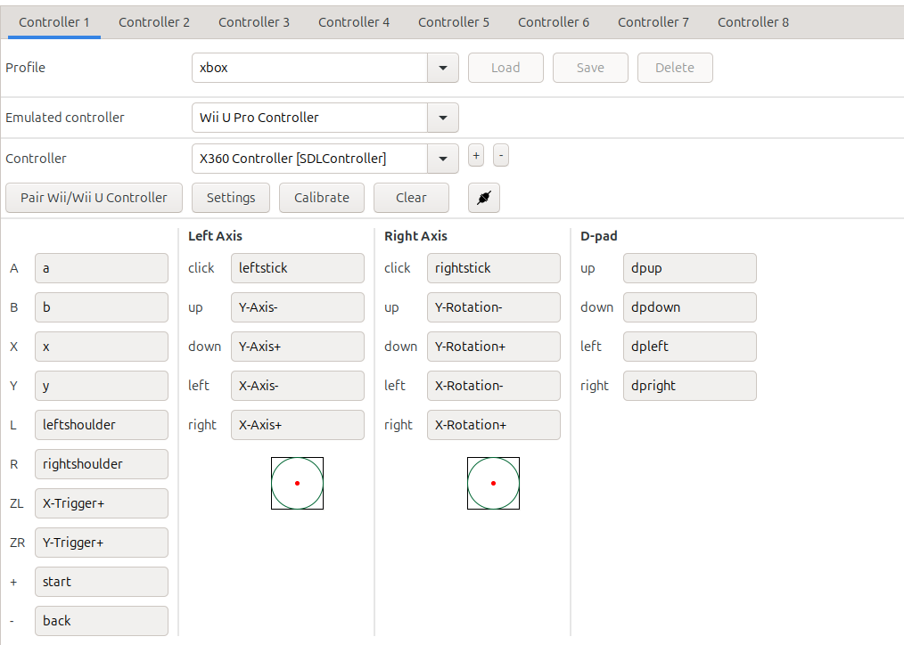

<p align="center"></p>

# XPadLink

[](https://github.com/josuebrunel/xpadlink/actions/workflows/ci.yml)
[](https://github.com/josuebrunel/xpadlink/releases)
[](LICENSE)

Use an Android phone, or a gamepad plugged into it, as a gamepad on your Linux PC.

```
phone (Flutter app) --UDP, 60 Hz--> xpadlinkd (Go) --/dev/uinput--> virtual Xbox 360 pad
```

## Contents

- [Features](#features)
- [Screenshots](#screenshots)
- [Quick start](#quick-start)
  - [1. Server (Linux PC)](#1-server-linux-pc)
  - [2. App (Android)](#2-app-android)
  - [3. Play](#3-play)
- [Bluetooth](#bluetooth)
- [Vibration and motion](#vibration-and-motion)
  - [Vibration](#vibration)
  - [Motion (gyro) in Cemu](#motion-gyro-in-cemu)
- [Calibration](#calibration)
- [Customizable touch controls](#customizable-touch-controls)
- [Run in the background](#run-in-the-background)
- [Troubleshooting](#troubleshooting)
- [Reference](#reference)
  - [Flags](#flags)
  - [Known gaps](#known-gaps)
- [Development](#development)
  - [Wire format](docs/PROTOCOL.md)
- [License](#license)

## Features

- A virtual Xbox 360 pad (`045e:028e`), so SDL, Steam, Proton, Cemu and browsers work without mapping.
- Customizable touch controls on the phone (reposition, scale, toggle visibility, adjust opacity, haptics, and presets), or a real controller plugged into it.
- Physical **Volume Up / Volume Down** key triggers (map to RT/LT, bumpers, face buttons, etc. with Hold or Toggle mode and Flip-180 auto-swap) and **Touch-Look** empty-screen swipe camera steering (`RX`/`RY`).
- Clean, unobstructed full-screen touch gameplay with a customizable floating menu button and Android Back button popup menu.
- Advanced Motion & Gyroscope tuning (~100 Hz): pure hardware gyro with accelerometer fallback toggle, zero-point drift calibration, and axis inversion (Pitch, Yaw, Roll) for Breath of the Wild apparatus shrines.
- Motion settings accessible both from the main menu and during gameplay.
- Over Wi-Fi, or over Bluetooth when there is no shared network.
- The app finds your PC on Wi-Fi by itself. No typing an IP.
- Up to 4 phones at once, one virtual pad each.
- A token keeps other people on your network from sending input.
- Vibration: a game's rumble buzzes the phone, or a controller with motors.
- Calibration for analog triggers (Hall effect pads), stick center and deadzone, and the phone's gyro.
- Motion for Cemu: the phone's tilt, for Wii U GamePad games and shrines.
- Runs as a background service on Linux, macOS and Windows.

## Screenshots

<table>
  <tr>
    <td></td>
    <td></td>
  </tr>
  <tr>
    <td align="center">Main connect screen with Wi-Fi discovery, Bluetooth pairing, and quick Gyro & Controls tuning</td>
    <td align="center">Unobstructed touch controls in active gameplay (top bar hidden)</td>
  </tr>
  <tr>
    <td></td>
    <td></td>
  </tr>
  <tr>
    <td align="center">In-game quick menu (opened via floating MENU button or Android Back button)</td>
    <td align="center">Motion & Gyro tuning: sensor fallback, BotW apparatus axis inversion, and drift calibration</td>
  </tr>
  <tr>
    <td></td>
    <td></td>
  </tr>
  <tr>
    <td align="center">Touch layout editor: drag-and-drop repositioning, per-control scaling, and visibility toggling</td>
    <td align="center">Scrollable layout presets (Xbox, PlayStation, Southpaw, Claw, Retro 2D)</td>
  </tr>
  <tr>
    <td></td>
    <td></td>
  </tr>
  <tr>
    <td align="center">Hidden controls readout view (auto-hides when a physical pad is connected)</td>
    <td align="center">Cemu maps the virtual controller and DSU motion server automatically</td>
  </tr>
</table>

## Quick start

You need three things: the server on your PC, the app on your phone, and both on the same Wi-Fi.

### 1. Server (Linux PC)

Download `xpadlinkd-linux-amd64.tar.gz` (or `arm64`) from the
[Releases](https://github.com/josuebrunel/xpadlink/releases) page and unpack it. Or build it (Go 1.22+):

```sh
git clone https://github.com/josuebrunel/xpadlink && cd xpadlink
make build            # produces server/xpadlinkd
```

One-time setup so you can create virtual pads without root, then log out and back in:

```sh
make uinput-setup     # loads uinput, installs the udev rule, adds you to the input group
make firewall         # only if you use ufw: opens UDP 9777
```

Start it. It prints the token and the addresses to use:

```sh
server/xpadlinkd
```

### 2. App (Android)

Download `xpadlink.apk` from the [Releases](https://github.com/josuebrunel/xpadlink/releases) page and install it
(allow "install unknown apps" for your browser or file manager when Android asks).

Or build it yourself. You need the [Flutter SDK](https://docs.flutter.dev/get-started/install) and a phone with USB debugging:

```sh
make app              # generates app/xpadlink_app (code, icon, permissions)
make app-run          # builds and runs on the connected phone
```

### 3. Play

1. Open the app. The connect screen has three tabs: **Saved**, **Wi-Fi** and **Bluetooth**. Servers on your Wi-Fi appear under the **Wi-Fi** tab.
2. Tap yours, enter the token, press **Connect**. **Save** keeps it for next time, and it then shows up under **Saved**. No Wi-Fi? See [Bluetooth](#bluetooth).
3. Use the touch controls, or plug in a controller. The touch controls hide when a controller is used.

Check it on the PC: `evtest` (pick `XPadLink - Xbox Controller 1`) or open
<https://hardwaretester.com/gamepad>.

During active gameplay, the screen is clean and unobstructed with no permanent top bar. Tap the floating **`[ ≡ MENU ]`** button or press the Android **Back** button to open the in-game menu: resume play, edit touch controls, hide controls (switch to readout view), flip the screen 180°, toggle motion streaming, or open **Motion & Gyro Settings** and **Hardware Calibration**.

## Bluetooth

The phone can reach the PC over Bluetooth instead of Wi-Fi. Wi-Fi and Bluetooth phones can play at the same time. It needs Linux with BlueZ (`bluetoothd`, which every desktop has).

1. Pair the phone with the PC once, in the Bluetooth settings of both.
2. Start `xpadlinkd`. It logs `bluetooth listening` (turn it off with `-bt=false`).
3. In the app, open the **Bluetooth** tab and press **Show paired devices** (Android 12 and later asks for the Bluetooth permission). Tap your PC, enter the token, press **Connect**. **Save** keeps it under **Saved**.

Same controls, vibration and motion as on Wi-Fi. If the connect fails, run `bluetoothctl trust <phone-address>` on the PC, and check that `bluetoothctl show` says `Powered: yes`.
If the PC doesn't show up when you pair from the phone, run `bluetoothctl pairable on` and `bluetoothctl discoverable on` on the PC first, or start the pairing from the PC.

## Vibration and motion

### Vibration

A game's rumble goes to the phone, or to your controller if it has motors. Nothing to set up. It is sent as media vibration, so it works even when "touch vibration" is off in the phone settings.
Check it without a game: connect the phone, then run `go run ./cmd/xpadrumble` in `server/`.

### Motion (gyro) in Cemu

The app streams the phone's gyroscope and accelerometer at ~100 Hz, and `xpadlinkd` serves them to Cemu as a DSU (Cemuhook) server on `127.0.0.1:26760`.

1. In Cemu, open **Options, Input settings** and set the emulated controller to **Wii U GamePad**.
2. Add a controller with the API **DSUController**, server `127.0.0.1`, port `26760`, and the controller index matching your player number minus one.
3. Hold the phone landscape, like a GamePad, and press **Calibrate** in Cemu.

**Motion & Gyroscope Tuning**:
- **Hardware Gyro vs. Fallback**: Phones with a physical gyroscope use pure low-latency hardware data (~100 Hz), avoiding synthetic rotation-vector lag and jitter. If your phone lacks a physical gyroscope, enable the **Accelerometer / Rotation Fallback** toggle.
- **Breath of the Wild Apparatus Shrines**: If shrine mazes (like Myahm Agana) flip upside down or rotate backwards in Cemu, use the **Invert Pitch**, **Invert Yaw**, or **Invert Roll** switches, and fine-tune responsiveness with the **Gyro Sensitivity** slider (0.5x to 3.0x).
- **Zero-Point Drift Calibration**: Lay the phone flat and still, then press **Measure Zero Point (2s)** to eliminate stationary cursor drift.
- **Accessing Motion Settings**: Tap the **`[GYRO]`** button in the main menu header or connection form, or open **Motion & Gyro Settings** from the in-game popup menu.

Use `-dsu ""` on `xpadlinkd` to turn the motion server off.

## Calibration

Open it via **Hardware Calibration** in the in-game menu. It has three tabs, and each one has its own **Save** and **Reset**.
Values are stored on the phone, per controller name, and applied in the app before anything is sent. The server and the wire format don't change.

- **Triggers.** Pull both triggers all the way, then let go. The app learns the lowest and highest value your pad reports and rescales that range to 0..255. This matters for Hall effect triggers, which rarely reach 100%, and for racing games that use them as throttle and brake. **Start over** clears the readings if you pulled badly.
- **Sticks.** With both sticks at rest, press **Set center**, then spin each stick around the edge. The app saves the resting center and how far each axis reaches. The deadzone slider (8% by default) is applied after that.
- **Motion.** Lay the phone flat and still, then press **Measure gyro**. Two seconds of readings become the gyro zero point, so the cursor stops drifting. If tilting the phone left moves the cursor right in Cemu, switch on **Flip roll**. Motion settings belong to the phone, not to a controller.

Triggers and sticks need a physical controller that has sent some input. Press a button first. The touch controls are not calibrated.

A pad that reports an analog trigger axis is read as analog. The L2/R2 key is only used as an on/off fallback for pads with no analog trigger axis.

## Customizable touch controls

The mobile app includes an interactive on-screen touch control customization system:
- **Reposition any control**: Drag sticks, D-pad, face buttons (ABXY), bumpers, triggers, center buttons, and the floating menu button anywhere on screen.
- **Per-control scaling**: Resize buttons and sticks between 50% and 200% to fit your hand size and screen layout.
- **Visibility toggles**: Hide unused buttons (such as L3/R3 or analog sticks for retro games).
- **Transparency**: Adjust global button opacity from subtle (10%) to solid (100%).
- **Haptic feedback**: Optional vibration feedback on button touches.
- **Floating Menu Button**: A customizable floating `[ ≡ MENU ]` button opens the quick in-game menu during gameplay.
- **Scrollable Layout Presets**:
  - **Default (Xbox)**: Standard asymmetrical layout.
  - **PlayStation Symmetrical**: Sticks at the bottom, D-pad and face buttons on top.
  - **Southpaw (Inverted)**: Swapped sticks and action buttons for left-handed players.
  - **4-Finger Claw**: Stacked top triggers and bumpers for multi-finger competitive claw grip.
  - **Retro / 2D Arcade**: Enlarged D-pad and buttons with analog sticks hidden.
- **Persistent storage**: Layouts are automatically saved to your device and restored across app restarts.
- **Accessing the editor**: Tap **CONTROLS** in the main menu header, or choose **Edit Controls** from the in-game popup menu.

### Volume Key Triggers & Touch-Look Camera

Open **INPUT** in the main menu header (or **VOLUME TRIGGERS** / **TOUCH-LOOK TUNING** inside the in-game menu) to configure:

- **Physical Volume Key Triggers**: Map the phone's **Volume Up** and **Volume Down** buttons to any Xbox 360 control (such as `RT`/`LT` triggers, `RB`/`LB`, `ABXY`, `L3`/`R3`, or D-Pad) with per-key **Hold** or **Toggle** mode, optional **Auto-Swap on Flip Screen (180°)**, and haptic feedback. Volume keys work normally for Android audio outside active gameplay or when set to **System Volume (Off)**.
- **Touch-Look Camera**: Drag empty screen space to steer the virtual Right Stick (`RX`/`RY`) without touching the stick circle. Choose between **Swipe Relatif (Trackpad)** (camera moves while your finger slides and stops when still, with configurable deadzone boost) and **Floating Stick** (virtual origin under your thumb), set active area (**Right Half** or **Full Screen**), sensitivity (`0.3x`–`3.0x`), axis inversion, and auto-hiding the on-screen Right Stick.

## Run in the background

`xpadlinkd install` registers a per-user service that starts at login and restarts on failure.
The token is saved once and reused, so the phone never needs a new one.

| | Linux | macOS | Windows |
|---|---|---|---|
| Install | `xpadlinkd install` | `xpadlinkd install` | `xpadlinkd install` |
| Mechanism | systemd user unit | launchd LaunchAgent | scheduled task at logon |
| Logs | `journalctl --user -u xpadlinkd -f` | `~/Library/Logs/xpadlinkd.log` | Task Scheduler history |
| Stop and remove | `xpadlinkd uninstall` | `xpadlinkd uninstall` | `xpadlinkd uninstall` |
| Token file | `~/.config/xpadlink/token` | `~/Library/Application Support/xpadlink/token` | `%AppData%\xpadlink\token` |

- Pass server flags after `install`: `xpadlinkd install -max 2 -log-level debug`.
- Show the token any time: `xpadlinkd token`.
- Linux: to start at boot instead of at login, run `loginctl enable-linger $USER`.
- Keep the binary where it is: the service points at its current path. Run `install` again after moving it.
- macOS and Windows can run the daemon, but only Linux can create the virtual pad (uinput). Use `-dry` there.

## Troubleshooting

| Problem | Fix |
|---------|-----|
| App says **Wrong token** | Run `xpadlinkd token` and re-enter it |
| App says **Server full** | Raise `-max`, or disconnect another phone |
| No servers under the Wi-Fi tab | Same Wi-Fi subnet? Guest networks block it. Type `ip:9777` instead. Check the firewall for UDP 9777 |
| `permission denied: /dev/uinput` | Run `make uinput-setup`, then log out and in |
| Game does not see the pad | `evtest` should list `XPadLink - ...`. Cemu may show the generic SDL name "Xbox 360 Controller" |
| Plugged-in controller not detected | A USB-C controller needs the phone's only port. Use wireless adb: `adb tcpip 5555 && adb connect <phone-ip>:5555`, then unplug the cable |
| Triggers act like on/off buttons | Open Calibration, pull each trigger fully on the **Triggers** tab and save. If it still jumps to full, open an issue with the controller model and the app log |
| Stick drifts or never reaches full | Calibrate it on the **Sticks** tab, or raise the deadzone |
| Screen is upside down | Open the in-game menu (floating MENU button or Android Back button) and tap **Flip Screen** |
| Cemu shows no motion | `ss -ulnp \| grep 26760` should list `xpadlinkd`, and the daemon log should say `dsu: client subscribed` once the DSUController is added. Check that Motion Streaming is on in the in-game menu |
| Motion is wrong or inverted in a game | Open **Motion & Gyro Settings** (from the main menu or in-game menu). Toggle **Invert Pitch**, **Invert Yaw**, or **Invert Roll** to fix upside-down apparatus shrines in BotW, measure the gyro zero point, and adjust sensitivity |
| Bluetooth connect fails | Pair first. Then `bluetoothctl trust <phone-address>`. `xpadlinkd` must log `bluetooth listening`; if it says `bluetooth disabled`, `bluetoothd` is not running |
| Input lags or drops | Watch the app log: `adb logcat -v time xpadlink:V flutter:V '*:S'`. A `link:` line every 5 s shows acks and send failures |

A Bluetooth controller paired to the phone should work the same as a USB one (Android lists it as a gamepad), but it is untested.

## Reference

### Flags

| Flag | Default | Meaning |
|------|---------|---------|
| `-listen` | `:9777` | UDP address |
| `-token` | saved token | Shared secret. Order: flag, `$XPADLINK_TOKEN`, token file (created on first run) |
| `-max` | `4` | Max simultaneous controllers |
| `-timeout` | `3s` | Drop a client after this much silence |
| `-bt` | on | Accept phones over Bluetooth (Linux, needs `bluetoothd`) |
| `-dsu` | `127.0.0.1:26760` | DSU motion server for Cemu, empty to disable |
| `-log-level` | `info` | `debug`, `info`, `warn`, `error` |
| `-dry` | off | Log input instead of creating pads (implies `debug`) |

Test without a phone: `xpadlinkd -token abc &` then `go run ./cmd/xpadsim -token abc` in `server/`.

### Known gaps

- Linux only for virtual pads. macOS and Windows builds compile and pass tests but are untested on real machines.
- Motion is wired to Cemu (DSU). Any apparatus shrine orientation issues in BOTW can be corrected using the axis inversion switches (Pitch, Yaw, Roll), sensitivity multiplier, and sensor fallback toggle in Motion & Gyro Settings.
- Wi-Fi is LAN only with no encryption: the token only stops other people on the network from injecting input. Bluetooth needs pairing, and the link is encrypted by Bluetooth itself.
- Bluetooth is Linux only, and untested with more than one phone at once.
- Calibration covers physical controllers only, and it has no screenshots in this README yet.
- Controllers that put the right stick on RX/RY instead of Z/RZ need a small change in `app/kotlin/MainActivity.kt`.

## Development

```sh
make help       # all targets
make test       # Go tests
make dry        # run the server without uinput
```

Check vibration without a game: connect the phone, then run `go run ./cmd/xpadrumble` in `server/`.
It plays a rumble effect on the virtual pad, the way a game would.

- CI (`.github/workflows/ci.yml`): tests on Linux, macOS and Windows, builds `xpadlinkd` for
  linux, darwin and windows (amd64, arm64) with [GoReleaser](https://goreleaser.com) (`.goreleaser.yaml`). Pushing a `v*` tag publishes a release with the archives and checksums.
- Wire format: [docs/PROTOCOL.md](docs/PROTOCOL.md).
- Layout: `server/` Go daemon (`proto`, `hub`, `bt`, `vpad`, `dsu`, `cmd/`), `app/` Flutter code (`lib/`: screens in `main.dart` and `onscreen.dart`, colours and shared widgets in `theme.dart`, Wi-Fi and Bluetooth links in `link.dart`) and Kotlin (`kotlin/`: gamepad and sensors in `MainActivity.kt`, the Bluetooth connection in `BtLink.kt`), copied into a generated project by `app/setup.sh`.

## License

[MIT](LICENSE). The bundled fonts (Chakra Petch, Barlow, JetBrains Mono) are under the SIL Open Font License, see `app/assets/fonts/`.
