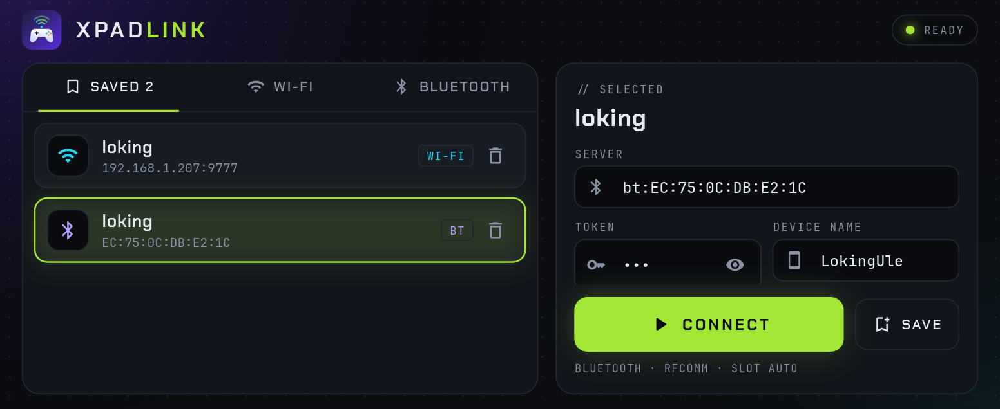
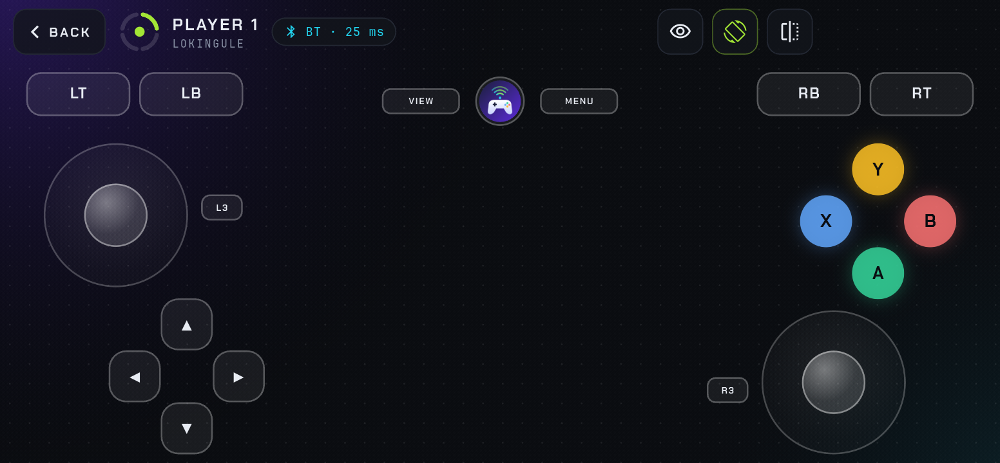
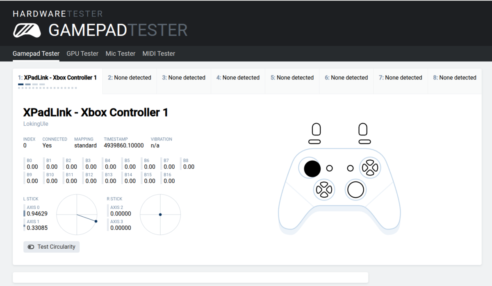
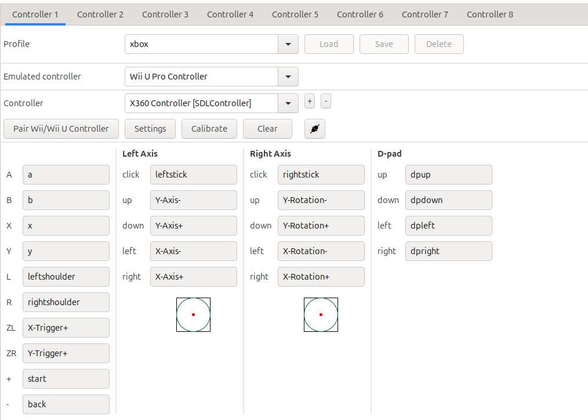

<p align="center"></p>

# XPadLink

Use an Android phone, or a gamepad plugged into it, as a gamepad on your Linux PC.

```
phone (Flutter app) --UDP, 60 Hz--> xpadlinkd (Go) --/dev/uinput--> virtual Xbox 360 pad
```

**What you get**

- A virtual Xbox 360 pad (`045e:028e`), so SDL, Steam, Proton, Cemu and browsers work without mapping.
- Touch controls on the phone, or a real controller plugged into it.
- The app finds your PC on Wi-Fi by itself. No typing an IP.
- Up to 4 phones at once, one virtual pad each.
- Vibration: a game's rumble buzzes the phone, or a controller with motors.
- Motion for Cemu (experimental): the phone's tilt, for Wii U GamePad games.

## Contents

| I want to... | Go to |
|--------------|-------|
| See what it looks like | [Screenshots](#screenshots) |
| Install it and play | [Quick start](#quick-start) |
| Get vibration or tilt in a game | [Vibration](#vibration) · [Motion in Cemu](#motion-gyro-in-cemu) |
| Start it automatically at login | [Run in the background](#run-in-the-background) |
| Fix a problem | [Troubleshooting](#troubleshooting) |
| Change a setting | [Flags](#flags) |
| Know what doesn't work yet | [Known gaps](#known-gaps) |
| Hack on it | [Development](#development) · [Wire format](docs/PROTOCOL.md) |

## Screenshots

<table>
  <tr>
    <td></td>
    <td></td>
  </tr>
  <tr>
    <td align="center">Find your PC on Wi-Fi, or pick a saved server</td>
    <td align="center">Touch controls. They hide when a real pad is used</td>
  </tr>
  <tr>
    <td></td>
    <td></td>
  </tr>
  <tr>
    <td align="center">The PC sees a standard gamepad</td>
    <td align="center">Cemu maps it with Auto-assign, no manual setup</td>
  </tr>
</table>

## Quick start

You need three things: the server on your PC, the app on your phone, and both on the same Wi-Fi.

### 1. Server (Linux PC)

Download `xpadlinkd-linux-amd64.tar.gz` (or `arm64`) from the
[Releases](https://github.com/josuebrunel/xpadlink/releases) page and unpack it. Or build it (Go 1.22+):

```sh
git clone https://github.com/josuebrunel/xpadlink && cd xpadlink
make build            # produces server/xpadlinkd
```

One-time setup so you can create virtual pads without root, then log out and back in:

```sh
make uinput-setup     # loads uinput, installs the udev rule, adds you to the input group
make firewall         # only if you use ufw: opens UDP 9777
```

Start it. It prints the token and the addresses to use:

```sh
server/xpadlinkd
```

### 2. App (Android)

There's no APK download yet, so build it. You need the [Flutter SDK](https://docs.flutter.dev/get-started/install) and a phone with USB debugging:

```sh
make app              # generates app/xpadlink_app (code, icon, permissions)
make app-run          # builds and runs on the connected phone
```

### 3. Play

1. Open the app. Servers on your Wi-Fi appear under **Nearby servers**.
2. Tap yours, enter the token, press **Connect**. **Save** keeps it for next time.
3. Use the touch controls, or plug in a controller. The touch controls hide when a controller is used.

Check it on the PC: `evtest` (pick `XPadLink - Xbox Controller 1`) or open
<https://hardwaretester.com/gamepad>.

In the app's bottom bar: the eye hides the touch controls, the rotation icon turns motion on or off, and the flip icon turns the screen upside down if it ended up the wrong way.

## Vibration

A game's rumble goes to the phone, or to your controller if it has motors. Nothing to set up.
Check it without a game: connect the phone, then run `go run ./cmd/xpadrumble` in `server/`.

### Motion (gyro) in Cemu

**Experimental.** Some Wii U games need the GamePad's motion sensors, like the maze shrines in Breath of the Wild.
The app sends the phone's gyro and accelerometer, and `xpadlinkd` serves them to Cemu as a DSU (Cemuhook) server on `127.0.0.1:26760`.

1. In Cemu, open **Options, Input settings** and set the emulated controller to **Wii U GamePad**.
2. Add a controller with the API **DSUController**, server `127.0.0.1`, port `26760`, and the controller index matching your player number minus one.
3. Hold the phone landscape, like a GamePad, and press **Calibrate** in Cemu.

No gyroscope on the phone? Many budget phones have none. The app then derives the turn rate from the rotation vector (accelerometer plus magnetometer). It's noisier and drifts near magnets.
On such a phone the BOTW maze shrine is not working yet (see [Known gaps](#known-gaps)).
Use `-dsu ""` to turn the motion server off.

## Run in the background

`xpadlinkd install` registers a per-user service that starts at login and restarts on failure.
The token is saved once and reused, so the phone never needs a new one.

| | Linux | macOS | Windows |
|---|---|---|---|
| Install | `xpadlinkd install` | `xpadlinkd install` | `xpadlinkd install` |
| Mechanism | systemd user unit | launchd LaunchAgent | scheduled task at logon |
| Logs | `journalctl --user -u xpadlinkd -f` | `~/Library/Logs/xpadlinkd.log` | Task Scheduler history |
| Stop and remove | `xpadlinkd uninstall` | `xpadlinkd uninstall` | `xpadlinkd uninstall` |
| Token file | `~/.config/xpadlink/token` | `~/Library/Application Support/xpadlink/token` | `%AppData%\xpadlink\token` |

- Pass server flags after `install`: `xpadlinkd install -max 2 -log-level debug`.
- Show the token any time: `xpadlinkd token`.
- Linux: to start at boot instead of at login, run `loginctl enable-linger $USER`.
- Keep the binary where it is: the service points at its current path. Run `install` again after moving it.
- macOS and Windows can run the daemon, but only Linux can create the virtual pad (uinput). Use `-dry` there.

## Troubleshooting

| Problem | Fix |
|---------|-----|
| App says **Wrong token** | Run `xpadlinkd token` and re-enter it |
| App says **Server full** | Raise `-max`, or disconnect another phone |
| No servers under Nearby | Same Wi-Fi subnet? Guest networks block it. Type `ip:9777` instead. Check the firewall for UDP 9777 |
| `permission denied: /dev/uinput` | Run `make uinput-setup`, then log out and in |
| Game does not see the pad | `evtest` should list `XPadLink - ...`. Cemu may show the generic SDL name "Xbox 360 Controller" |
| Plugged-in controller not detected | A USB-C controller needs the phone's only port. Use wireless adb: `adb tcpip 5555 && adb connect <phone-ip>:5555`, then unplug the cable |
| Screen is upside down | Press the flip icon in the app's bottom bar |
| Cemu shows no motion | `ss -ulnp \| grep 26760` should list `xpadlinkd`, and the daemon log should say `dsu: client subscribed` once the DSUController is added. `motion unavailable` in the app log means the phone has no gyroscope and no rotation vector sensor. Check the rotation icon is on |
| Motion is wrong in a game | Press **Calibrate** in Cemu with the phone held steady. Open an issue with the game and what happens |
| Input lags or drops | Watch the app log: `adb logcat -v time xpadlink:V flutter:V '*:S'`. A `link:` line every 5 s shows acks and send failures |

Bluetooth controllers should work the same as USB ones (Android lists them as gamepads) but are untested.

## Flags

| Flag | Default | Meaning |
|------|---------|---------|
| `-listen` | `:9777` | UDP address |
| `-token` | saved token | Shared secret. Order: flag, `$XPADLINK_TOKEN`, token file (created on first run) |
| `-max` | `4` | Max simultaneous controllers |
| `-timeout` | `3s` | Drop a client after this much silence |
| `-dsu` | `127.0.0.1:26760` | DSU motion server for Cemu, empty to disable |
| `-log-level` | `info` | `debug`, `info`, `warn`, `error` |
| `-dry` | off | Log input instead of creating pads (implies `debug`) |

Test without a phone: `xpadlinkd -token abc &` then `go run ./cmd/xpadsim -token abc` in `server/`.

## Known gaps

- Linux only for virtual pads. macOS and Windows builds compile and pass tests but are untested on real machines.
- Motion is experimental. It reaches Cemu, but in the BOTW maze shrine the maze still flips upside down (tested on a phone without a gyroscope, #32). It is only wired to Cemu (DSU).
- No APK download yet: build the app with Flutter.
- LAN only, no encryption. The token only stops other people on the network from injecting input.
- Controllers that put the right stick on RX/RY instead of Z/RZ need a small change in `app/kotlin/MainActivity.kt`.

## Development

```sh
make help       # all targets
make test       # Go tests
make dry        # run the server without uinput
```

Check vibration without a game: connect the phone, then run `go run ./cmd/xpadrumble` in `server/`.
It plays a rumble effect on the virtual pad, the way a game would.

- CI (`.github/workflows/ci.yml`): tests on Linux, macOS and Windows, builds `xpadlinkd` for
  linux, darwin and windows (amd64, arm64) with [GoReleaser](https://goreleaser.com) (`.goreleaser.yaml`). Pushing a `v*` tag publishes a release with the archives and checksums.
- Wire format: [docs/PROTOCOL.md](docs/PROTOCOL.md).
- Layout: `server/` Go daemon (`proto`, `hub`, `vpad`, `dsu`, `cmd/`), `app/` Flutter code, copied into a generated project by `app/setup.sh`.

## License

[MIT](LICENSE)
